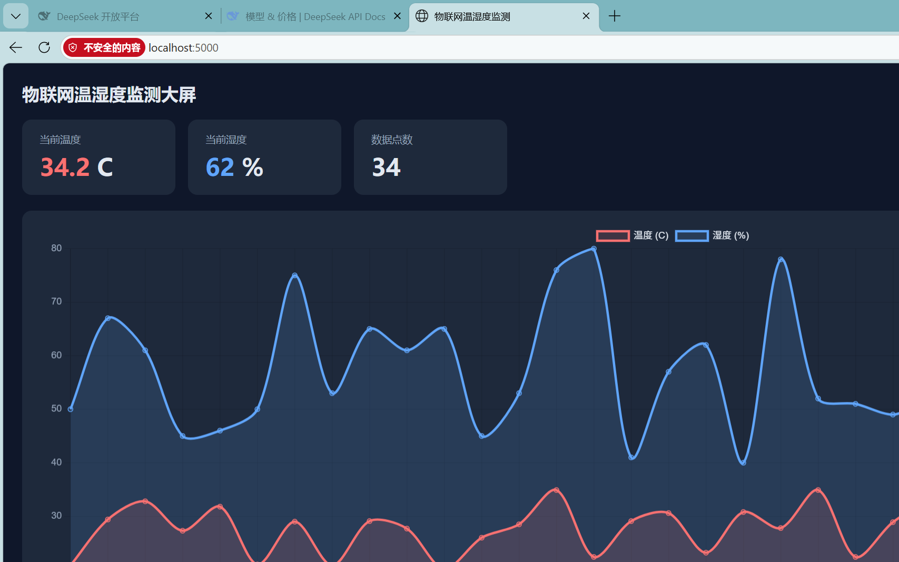

# 物联网温湿度监测系统

一个端到端的物联网数据采集与可视化项目：模拟传感器采集数据 → MQTT 上报 → 服务器订阅处理 → 网页实时展示。



## ✨ 功能

- **数据采集**：定时采集温湿度数据（支持命令行参数配置采集次数与间隔）
- **MQTT 上报**：通过 MQTT 协议发布 JSON 数据到指定主题
- **服务端处理**：订阅主题，反序列化数据，持久化到 JSON Lines 日志
- **阈值告警**：温度超过阈值时实时告警
- **实时可视化**：Flask + Chart.js 网页大屏，实时曲线 + 数字卡片（每 2 秒刷新）
- **模块化设计**：采集、判断、统计逻辑封装为独立模块 `sensor_lib.py`

## 🏗️ 系统架构

```
┌──────────────┐   发布    ┌────────────┐   订阅    ┌────────────────────┐
│ 设备端        │ ───────> │  MQTT      │ ───────> │  服务器端            │
│ sensor_      │          │  Broker    │          │  data_collector.py │
│ publisher.py │          │ (mosquitto)│          │  订阅→落盘→告警      │
└──────────────┘          └────────────┘          └────────────────────┘
                                                          │
                                                          │
                                                  ┌───────▼────────┐
                                                  │ 网页大屏         │
                                                  │ dashboard.py    │
                                                  │ Flask + Chart.js│
                                                  └────────────────┘
```

## 🛠️ 技术栈

| 类别 | 技术 |
|------|------|
| 语言 | Python 3.10 |
| 通信协议 | MQTT (paho-mqtt)、HTTP |
| 消息中间件 | Mosquitto Broker |
| Web 框架 | Flask |
| 前端图表 | Chart.js |
| 数据格式 | JSON / JSON Lines / CSV |
| 开发环境 | WSL2 + Ubuntu 22.04、Linux 命令行、Git |

## 📁 目录结构

```
iot-lab/
├── sensor_lib.py          # 传感器数据模块(采集/告警判断/统计)
├── sensor_publisher.py    # 设备端: 采集并发布数据到 MQTT
├── data_collector.py      # 服务器端: 订阅数据、落盘、告警
├── dashboard.py           # 网页大屏(Flask + MQTT)
├── collect_tool.py        # 命令行采集工具(定时采集+报告)
├── collect.sh             # Shell 版采集脚本
├── start_broker.sh        # 一键启动 MQTT Broker
├── start_demo.sh          # 一键启动完整演示
├── docs/
│   └── dashboard.png      # 大屏效果图
└── README.md
```

## 🚀 运行方法

```bash
# 1. 启动 MQTT Broker
~/iot-lab/start_broker.sh

# 2. 启动网页大屏(后台)
cd ~/iot-lab
nohup python3 dashboard.py > /tmp/dashboard.log 2>&1 &

# 3. 浏览器打开
#    http://localhost:5000

# 4. 模拟设备上报数据
python3 sensor_publisher.py 30 1

# 5. 服务端订阅并落盘(可选)
python3 data_collector.py
```

## 🔭 后续计划

- [ ] 接入真实硬件（ESP32 + DHT22 温湿度传感器 + OLED 显示）
- [ ] 数据接入云平台（阿里云 IoT / EMQX Cloud）
- [ ] 增加历史数据查询与告警推送

## 👤 作者

xcn666 · 2026
